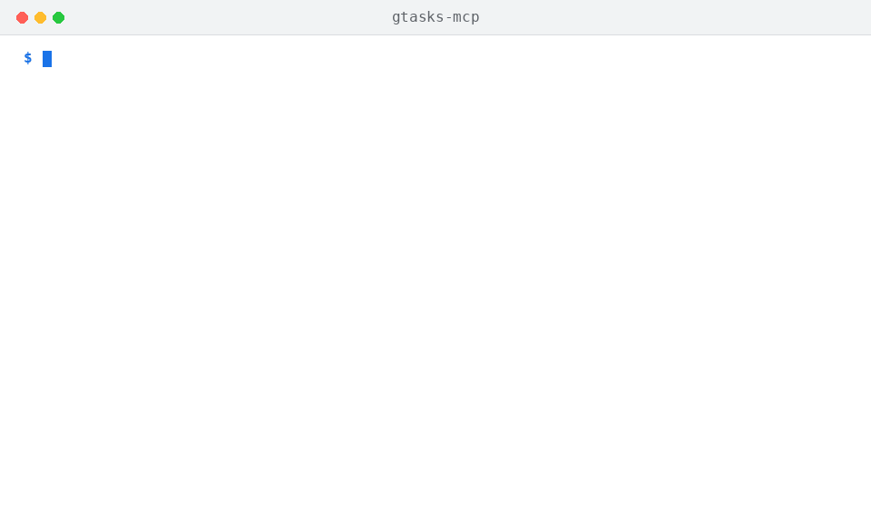
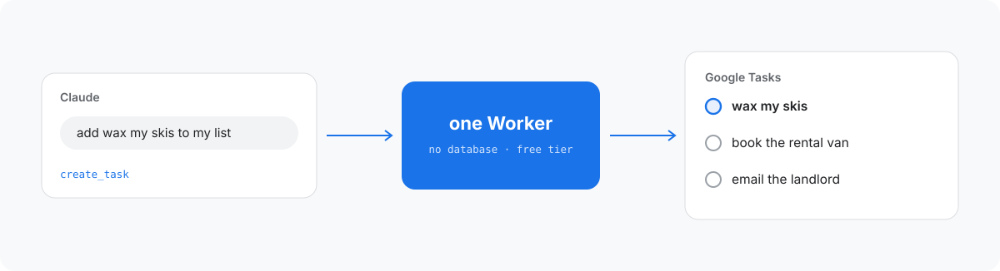

# gtasks-mcp

I keep my whole to do list in Google Tasks and wanted to add to it by just messaging Claude, so I built the connector.



## Run it

```
npm install
npm run setup
```

You need a Google OAuth client and a Cloudflare account first, [docs/SETUP.md](docs/SETUP.md) has the clicks. Setup prints an address when it finishes. Add it in Claude under Settings, Connectors, Add custom connector.
